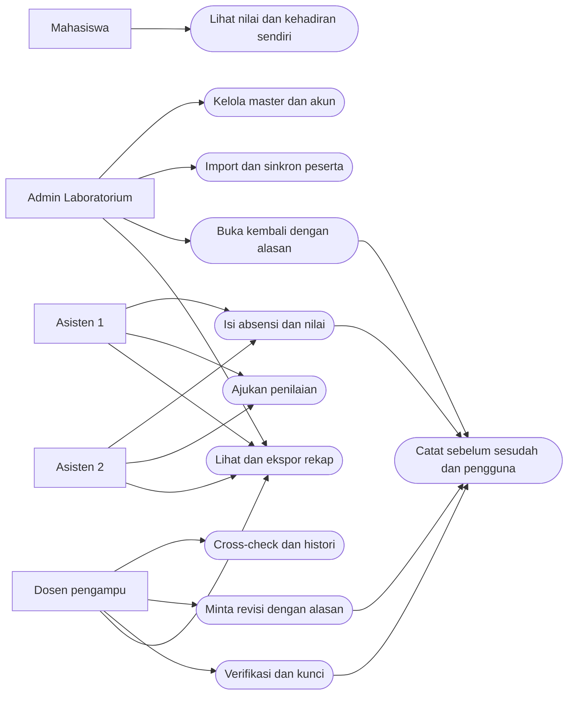
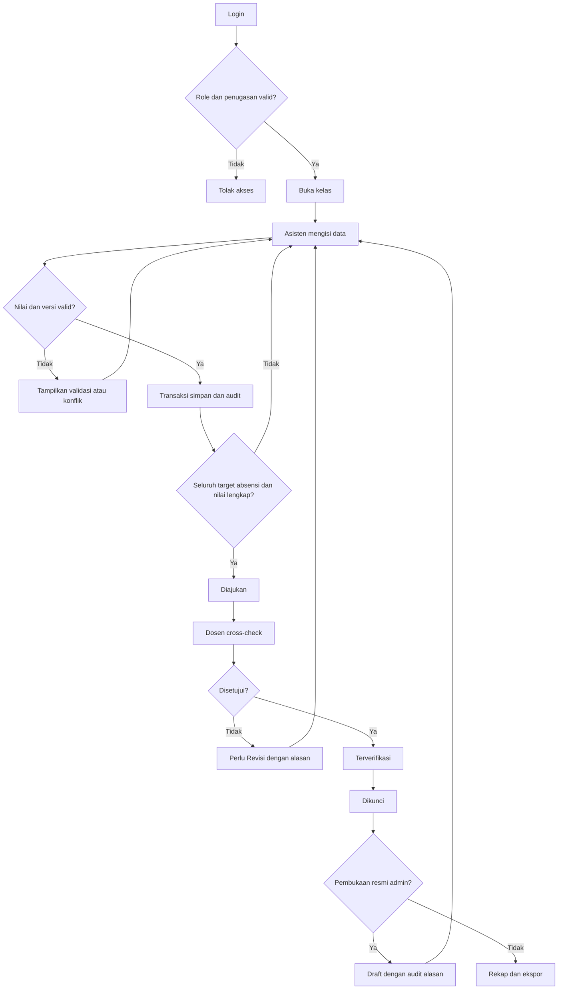
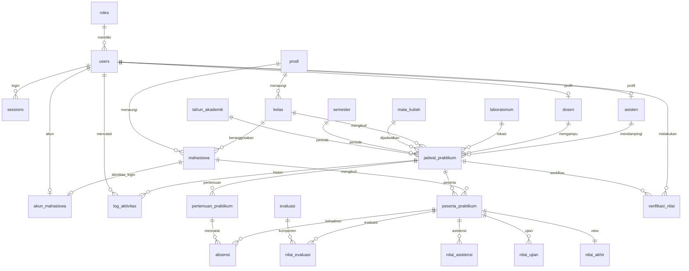

# Analisis dan rancangan sistem

## Kebutuhan dan aktor

Admin mengelola master akademik, akun, peserta, penugasan, konfigurasi huruf, dan pembukaan kunci. Asisten 1/2 mengisi absensi dan nilai hanya di jadwal yang ditugaskan. Dosen memeriksa kelas yang diampu, mengembalikan dengan alasan, memverifikasi, dan mengunci. Role staf dapat melihat dan mengekspor kelas dalam kewenangannya. Mahasiswa login melalui akun yang dihubungkan admin ke satu NIM untuk melihat hanya nilai serta kehadirannya sendiri melalui Nilai Saya. Mahasiswa tidak memiliki akses ekspor kelas, audit staf, atau pengeditan.

## Use case diagram

## Activity diagram

## ERD

`nilai_akhir` merupakan view komponen, lalu pembobotan dihitung server untuk menghindari duplikasi nilai turunan. `konfigurasi_nilai` berisi batas bawah huruf inklusif dengan nilai unik, termasuk batas nol. Tidak ada rentang hardcoded pada fungsi kalkulasi; data awal di-seed satu kali. Asisten 1 dan 2 adalah dua FK berbeda pada jadwal.

## Integritas dan konkurensi

Unik: email, NIM, kode MK, pasangan jadwal/mahasiswa, jadwal/nomor pertemuan, peserta/komponen. FK mencegah referensi yatim. Validasi API membatasi maksimal 14 pertemuan, evaluasi/asistensi dinamis, nilai 0–100, jenis ujian, status absensi, dan penugasan asisten berbeda. API memastikan peserta dan pertemuan berasal dari jadwal sama. Setiap penyimpanan memeriksa versi jadwal dan menaikkan versi. Transaksi menggunakan MySQL InnoDB dan SELECT FOR UPDATE pada jadwal; audit ikut rollback bila input tidak valid. Trigger menolak pengubahan dan penghapusan catatan audit.

## Pemetaan implementasi

| Kebutuhan | Implementasi |
| --- | --- |
| Login dan hak akses | Session server, role, penugasan kelas pada setiap endpoint |
| Dashboard | Ringkasan kelas/peserta, progres, kebutuhan input/revisi/verifikasi |
| Master akademik | Form tambah/edit relasional; aktivasi jadwal dan akun |
| Absensi | maksimal 14 pertemuan, tanggal/materi, H/I/S/A/T, catatan, hadirkan semua |
| Evaluasi dan ujian | evaluasi/asistensi dinamis, MID/UAS; tombol simpan dan validasi |
| Cross-check | Rekap, detail mahasiswa, audit sebelum/sesudah |
| Verifikasi | Draft, Diajukan, Perlu Revisi, Terverifikasi, Dikunci |
| Laporan | Pencarian/filter, detail kelas, Excel lengkap, PDF rekap, print |
| Audit | Identitas, role, waktu UTC, IP, nilai lama/baru |
| UI | Sidebar, tabel sticky, scroll horizontal, breakpoint mobile |

Audit menyimpan waktu UTC, UI menampilkan zona waktu perangkat. Data awal adalah contoh untuk orientasi penggunaan, bukan arsip resmi. Kebutuhan kebijakan kampus yang belum diberikan (misalnya perlakuan terlambat dan pembatalan peserta historis) dinyatakan secara eksplisit dalam README.
